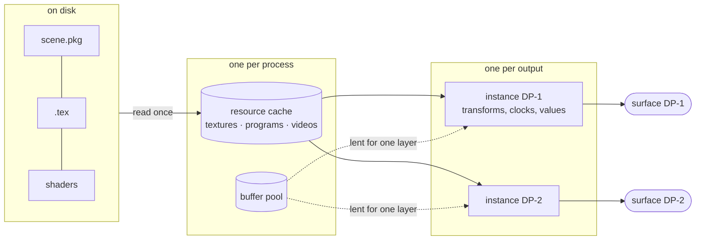

<div align="center">

# wepaper

**Wallpaper Engine wallpapers as your Wayland desktop background.**<br>
Scenes, videos and web wallpapers from the Steam Workshop, on every monitor,<br>
fast and light on the machine.

[](https://github.com/MoonTiwzy/wepaper/actions/workflows/ci.yml)
[](LICENSE)


[Install](#install) · [Quick start](#quick-start) · [Control](#control) · [Plugins](#plugins) · [How it stays small](#how-it-stays-small) · [Русский](README.ru.md)

</div>

```sh
wepaper daemon &                 # once, with your session
wepaper show 3566329932          # a workshop id, or a folder
wepaper set config/fps 30
wepaper set outputs/DP-1/wallpaper/properties/schemecolor "0.2 0.4 1"
```

wepaper is one small binary in the tradition of `hyprpaper` and `mpvpaper`: a daemon that
draws, a command line that tells it what, nothing else. It reads the wallpapers Wallpaper
Engine already put on your disk and plays them itself. Looking for a window to browse and
subscribe with? That is [WE Linux](https://github.com/MoonTiwzy/we-linux), which runs wepaper
underneath.

## Fast and light

wepaper starts in a fraction of a second, takes little memory and video memory, and leaves the
CPU alone: one process and one OpenGL context for every monitor, and nothing running that the
wallpaper on screen does not use. Where that comes from is in
[How it stays small](#how-it-stays-small); the measurements, for those who want them, are in
[docs/performance.md](docs/performance.md).

## What it plays

| | |
|---|---|
| **Scenes** | image layers with their materials and blend modes, effect chains, compose and fullscreen layers, text, particles, puppet warp, sprite sheets, video textures, sound, camera parallax and shake, bloom, keyframe animations, audio-reactive shaders, SceneScript, user properties |
| **3D scenes** | the perspective camera and camera objects, 3D models with their materials, skeletons and animations, lights, reflections, the high dynamic range pipeline with its bloom |
| **Videos** | any video libmpv plays, with cover / contain / stretch, sound, and a frame drawn only when the video has a new one |
| **Web** | pages with Wallpaper Engine's JavaScript API, through the bundled [`web` plugin](plugins/web) |
| **Presets** | a preset plays its wallpaper with its values |

What is not there yet (shadows, fog, camera paths, among others) and how every feature
was checked is in [docs/compatibility.md](docs/compatibility.md). `wepaper check` tells you
about your own library:

```console
$ wepaper check ~/.local/share/Steam/steamapps/workshop/content/431960
104 complete, 3 with parts not shown, 0 did not load, 6 of a kind left to plugins
```

## Install

wepaper needs a compositor with `wlr-layer-shell` (Hyprland, sway, niri, river, KDE Plasma,
labwc, ...; not GNOME), OpenGL 3.3, and Wallpaper Engine installed through Steam: its stock
shaders and effects are used, and nothing of it is bundled here.

**Arch Linux**

```sh
git clone https://github.com/MoonTiwzy/wepaper && cd wepaper/packaging/arch && makepkg -si
```

**From source**

```sh
cargo build --release                      # about a minute; the binary is target/release/wepaper
cargo build --release -p wepaper-web       # optional: web wallpapers (needs GTK 4 and WebKitGTK 6)
install -Dm755 target/release/wepaper ~/.local/bin/wepaper
```

At run time, and only when a wallpaper asks for it: `libmpv` (video and sound), `ffmpeg`
(to make cheaper copies of oversized videos), `parec` from PulseAudio or PipeWire's Pulse
tools (audio-reactive wallpapers), `fc-match` (text layers that name a system font),
`playerctl` (wallpapers that show the track your player is on). None of them is linked in;
without one, the feature it serves is simply not there.

## Quick start

```sh
wepaper daemon                             # shows what it showed last
wepaper show 3566329932                    # on every monitor
wepaper show ~/Videos/loop.mp4.d --on DP-2 # a folder with a project.json, on one monitor
wepaper status
wepaper pause --on DP-1                    # freeze on the current frame; resume picks up there
wepaper snapshot ~/now.png                 # what is on screen, as a PNG
wepaper hide
```

Start it with your session: `exec-once = wepaper daemon` in Hyprland, or the systemd user
unit in [`packaging/systemd`](packaging/systemd). On Hyprland, put it above a static
wallpaper setter with a layer rule on the `wepaper` namespace.

## Control

Everything the daemon knows is one tree, and the command line is a handful of verbs over
it. There is no command per setting: if you can `get` it, you can usually `set` it.

```
config/              fps, volume, mute, fill, layer, passthrough, audio_response, video_hardware, ...
outputs/<name>/      size, scale, paused, fill, fps
outputs/<name>/wallpaper/
    path, kind, title
    properties/<name>                        the user properties
    scene/                                   zoom, clear, bloom, parallax..., shake..., ambient, skylight
    layers/<id>/                             visible, origin, scale, angles, alpha, color, text, volume
    layers/<id>/constants/<name>             the constants of the layer's shader
    layers/<id>/effects/<n>/visible
    layers/<id>/effects/<n>/constants/<name> an effect's strength, speed, colours
plugins/<id>/        enabled, params/<name>
memory/              textures, buffers, video
```

```sh
wepaper get config                          # a whole branch, as JSON
wepaper list outputs/DP-1/wallpaper/layers
wepaper set outputs/DP-1/wallpaper/layers/426/alpha 0.5
wepaper set 'outputs/*/wallpaper/layers/426/effects/0/visible' false
wepaper set outputs/DP-1/wallpaper/layers/13/effects/0/constants/speed 0.3
wepaper reset outputs/DP-1/wallpaper        # the wallpaper back to its own values
wepaper watch                               # events, one JSON object a line
```

What is changed inside a wallpaper is remembered for that wallpaper and comes back the next
time it is shown, on any monitor and after a restart. `reset` forgets it.

The same verbs are the protocol: one JSON object per line over
`$XDG_RUNTIME_DIR/wepaper.sock`, answered in order. From Rust there is the
[`wepaper-ipc`](ipc) crate; from anything else, a socket and a JSON library. The full
reference is [docs/ipc.md](docs/ipc.md).

```console
$ echo '{"cmd":"get","path":"memory"}' | socat - UNIX-CONNECT:$XDG_RUNTIME_DIR/wepaper.sock
{"ok":true,"value":{"textures":11272192,"buffers":14745600,"video":0,"videos":0,"optimising":0,"listening":false,"peak_effect_buffers":1}}
```

## Configuration

`$XDG_CONFIG_HOME/wepaper/config.json` (comments and trailing commas are fine). Every key
is optional, and every key is also a node under `config/`:

```jsonc
{
  "fps": 0,                // frames a second at most; 0 follows the display
  "mute": true,            // no sound at all: sound tracks are not even decoded
  "volume": 100,
  "fill": "cover",         // cover | contain | stretch
  "layer": "background",   // background | bottom
  "passthrough": false,    // true: the pointer goes to what is under the wallpaper
  "audio_response": true,  // audio-reactive wallpapers hear what the system plays
  "video_hardware": false, // decode video on the GPU: less CPU, more video memory
  "video_max_width": 0,    // keep video frames no wider than this; 0 is the widest monitor
  "texture_max_side": 0    // load textures no larger than this on a side; 0 for no limit
}
```

What is set over the socket wins over the file until `wepaper reload`. `--set key=value` on
the daemon's command line is what a setting starts from, whatever the file and earlier runs
say. See
[docs/configuration.md](docs/configuration.md).

## Plugins

A plugin is a folder with a `plugin.json`, in `~/.config/wepaper/plugins/` or
`/usr/share/wepaper/plugins/`. There are four kinds:

| kind | what it is | example |
|---|---|---|
| `hook` | a command run when something happens, told what through `WEPAPER_*` variables | recolour your bar when the wallpaper changes |
| `service` | a process the daemon keeps running, which talks to it over the socket | pause on battery, a playlist |
| `shader` | a fragment shader run over every finished frame, with parameters you can `set` live | [`dim`](plugins/dim), [`vignette`](plugins/vignette) |
| `renderer` | a process that draws a kind of wallpaper the daemon does not | [`web`](plugins/web) |

```sh
wepaper set plugins/dim/enabled true
wepaper set plugins/dim/params/u_Amount 0.5
```

Writing one takes a manifest and a file: [docs/plugins.md](docs/plugins.md).

## Tools

The same binary works on wallpapers without showing them, and without a compositor:

```sh
wepaper render 3566329932 -o frame.png --size 2560x1440 --time 2   # one frame, headless
wepaper inspect 3566329932                                         # layers, effects, properties
wepaper check <wallpaper or folder of them>                        # what does not work, and why
wepaper unpack 3566329932 ./files                                  # the files of a scene.pkg
```

## How it stays small

The footprint is a design decision, not a set of switches.



- **One OpenGL context for every output.** A texture, a compiled shader or a video frame is
  one object however many monitors show it. A playing wallpaper owns only its state.
- **Shaders go to the driver as they are.** Wallpaper Engine's shaders are GLSL already: a
  preprocessor and a prelude replace a shader cross-compiler, its build time and its start-up
  time. Linked programs are cached on disk, so a warm start compiles nothing.
- **Effect buffers are borrowed.** A layer needs its buffers only while its effect chain
  runs. They come from a pool and go back, so video memory follows the deepest chain, not the
  number of layers, and they are sized by what reaches the screen, not by what the artist
  exported.
- **Scenes draw straight into the surface.** No full-screen buffer in between, no blit.
- **Textures stay compressed** on the GPU when they are stored compressed, and levels that
  cannot reach the screen are never read from disk.
- **Video is decoded once per file** and drawn by libmpv directly into a texture in the same
  context. Oversized videos get a cheaper copy in the background, and playback moves to it
  without a restart. A video loops without a seam: the player is given it as one long tape
  of copies, so it never seeks back.
- **Nothing runs until it is needed.** No audio capture unless a visible wallpaper reads the
  spectrum, no sound decoding while muted, no frame when a video has no new one, no effect
  buffers for a paused output, no script interpreter for a scene without scripts.
- **Values change in place.** A user property, a layer's opacity, an effect's switch: a write
  into the running scene. Nothing reloads.

The longer version is [docs/architecture.md](docs/architecture.md).

## Building and testing

```sh
cargo build                                   # a clean debug build takes seconds
cargo test --workspace
WEPAPER_TEST_ASSETS=~/.local/share/Steam/steamapps/common/wallpaper_engine/assets \
WEPAPER_TEST_WORKSHOP=~/.local/share/Steam/steamapps/workshop/content/431960 \
    cargo test --workspace                    # the same, plus every wallpaper on your disk
```

| | |
|---|---|
| [`src/`](src) | the binary: the daemon (`daemon/`) and the command line (`cli/`) |
| [`engine/`](engine) | `wepaper-engine`: a wallpaper folder in, frames out; no Wayland, no IPC |
| [`ipc/`](ipc) | `wepaper-ipc`: the protocol and a client |
| [`json/`](json) | `wepaper-json`: JSON as wallpapers actually write it |
| [`web/`](web) | `wepaper-web`: the web wallpaper renderer plugin |
| [`plugins/`](plugins) | the bundled plugins |
| [`tools/`](tools) | developer scripts: a hidden compositor to test in, golden comparisons, footprint |

See [CONTRIBUTING.md](CONTRIBUTING.md).

## License

GPL-2.0-or-later. wepaper is an independent project: it is not affiliated with Wallpaper
Engine, and ships none of its files. You need your own copy of Wallpaper Engine.
