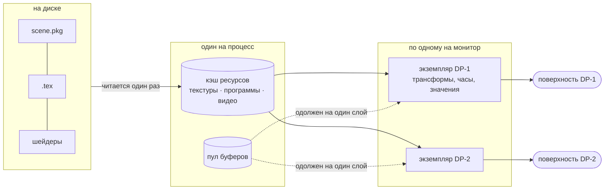

<div align="center">

# wepaper

**Обои Wallpaper Engine как фон рабочего стола на Wayland.**<br>
Сцены, видео и веб-обои из мастерской Steam, на каждом мониторе,<br>
быстро и бережно к железу.

[](https://github.com/MoonTiwzy/wepaper/actions/workflows/ci.yml)
[](LICENSE)


[Установка](#установка) · [Быстрый старт](#быстрый-старт) · [Управление](#управление) · [Плагины](#плагины) · [Почему так мало ест](#почему-так-мало-ест) · [English](README.md)

</div>

```sh
wepaper daemon &                 # один раз, вместе с сессией
wepaper show 3566329932          # id из мастерской или папка
wepaper set config/fps 30
wepaper set outputs/DP-1/wallpaper/properties/schemecolor "0.2 0.4 1"
```

wepaper это один небольшой бинарник в духе `hyprpaper` и `mpvpaper`: демон, который рисует, и
командная строка, которая говорит ему что. Больше ничего. Он читает обои, которые Wallpaper
Engine уже положил на диск, и проигрывает их сам. Нужно окно, чтобы листать мастерскую и
подписываться? Это [WE Linux](https://github.com/MoonTiwzy/we-linux), под капотом у него wepaper.

## Быстрый и лёгкий

wepaper запускается за доли секунды, ест мало памяти и видеопамяти и не грузит процессор: один
процесс и один контекст OpenGL на все мониторы, и ничего не работает, пока это не нужно обоям на
экране. Откуда это берётся, рассказано в разделе [Почему так мало ест](#почему-так-мало-ест), а
замеры для любопытных лежат в [docs/performance.md](docs/performance.md).

## Что он играет

| | |
|---|---|
| **Сцены** | слои-картинки с материалами и режимами смешивания, цепочки эффектов, compose- и fullscreen-слои, текст, частицы, puppet warp, спрайт-листы, видео-текстуры, звук, параллакс и тряска камеры, bloom, покадровые анимации, шейдеры с реакцией на звук, SceneScript, пользовательские свойства |
| **3D-сцены** | перспективная камера и объекты-камеры, 3D-модели с материалами, скелетами и анимациями, свет, отражения, HDR-конвейер со своим bloom |
| **Видео** | любое видео, которое играет libmpv: cover / contain / stretch, звук, кадр рисуется только когда у видео появился новый |
| **Веб** | страницы с JavaScript API Wallpaper Engine, через встроенный [плагин `web`](plugins/web) |
| **Пресеты** | пресет играет свои обои со своими значениями |

Чего пока нет (тени, туман, пути камеры и кое-что ещё) и как проверялась каждая возможность, написано в
[docs/compatibility.md](docs/compatibility.md). Про твою библиотеку расскажет `wepaper check`:

```console
$ wepaper check ~/.local/share/Steam/steamapps/workshop/content/431960
104 complete, 3 with parts not shown, 0 did not load, 6 of a kind left to plugins
```

## Установка

Нужен композитор с `wlr-layer-shell` (Hyprland, sway, niri, river, KDE Plasma, labwc и другие;
не GNOME), OpenGL 3.3 и Wallpaper Engine, установленный через Steam: используются его штатные
шейдеры и эффекты, с собой wepaper ничего из него не несёт.

**Arch Linux**

```sh
git clone https://github.com/MoonTiwzy/wepaper && cd wepaper/packaging/arch && makepkg -si
```

**Из исходников**

```sh
cargo build --release                      # около минуты; бинарник в target/release/wepaper
cargo build --release -p wepaper-web       # по желанию: веб-обои (нужны GTK 4 и WebKitGTK 6)
install -Dm755 target/release/wepaper ~/.local/bin/wepaper
```

Во время работы, и только когда обои этого просят: `libmpv` (видео и звук), `ffmpeg`
(дешёвые копии слишком больших видео), `parec` из PulseAudio или Pulse-утилит PipeWire (обои с
реакцией на звук), `fc-match` (текстовые слои с системным шрифтом), `playerctl` (обои, которые
показывают трек из твоего плеера). Ничто из этого не линкуется: нет программы, значит просто нет
возможности, которой она служит.

## Быстрый старт

```sh
wepaper daemon                             # показывает то, что показывал в прошлый раз
wepaper show 3566329932                    # на всех мониторах
wepaper show ~/Videos/loop.mp4.d --on DP-2 # папка с project.json, на одном мониторе
wepaper status
wepaper pause --on DP-1                    # замереть на текущем кадре; resume продолжит с него
wepaper snapshot ~/now.png                 # что сейчас на экране, в PNG
wepaper hide
```

Запуск вместе с сессией: `exec-once = wepaper daemon` в Hyprland или пользовательский юнит
systemd из [`packaging/systemd`](packaging/systemd). В Hyprland поднять его над статичными
обоями можно правилом слоя на пространство имён `wepaper`.

## Управление

Всё, что знает демон, это одно дерево, а командная строка это горсть глаголов над ним.
Отдельной команды на каждую настройку нет: что можно прочитать через `get`, то обычно можно
и поменять через `set`.

```
config/              fps, volume, mute, fill, layer, passthrough, audio_response, video_hardware, ...
outputs/<имя>/       size, scale, paused, fill, fps
outputs/<имя>/wallpaper/
    path, kind, title
    properties/<имя>                         пользовательские свойства
    scene/                                   zoom, clear, bloom, parallax..., shake..., ambient, skylight
    layers/<id>/                             visible, origin, scale, angles, alpha, color, text, volume
    layers/<id>/constants/<имя>              константы шейдера слоя
    layers/<id>/effects/<n>/visible
    layers/<id>/effects/<n>/constants/<имя>  сила, скорость, цвета эффекта
plugins/<id>/        enabled, params/<имя>
memory/              textures, buffers, video
```

```sh
wepaper get config                          # целая ветка, в JSON
wepaper list outputs/DP-1/wallpaper/layers
wepaper set outputs/DP-1/wallpaper/layers/426/alpha 0.5
wepaper set 'outputs/*/wallpaper/layers/426/effects/0/visible' false
wepaper set outputs/DP-1/wallpaper/layers/13/effects/0/constants/speed 0.3
wepaper reset outputs/DP-1/wallpaper        # вернуть обои к их собственным значениям
wepaper watch                               # события, по одному JSON-объекту в строке
```

Что поменяно внутри обоев, запоминается за этими обоями и возвращается при следующем показе,
на любом мониторе и после перезапуска. `reset` это забывает.

Те же глаголы и есть протокол: по одному JSON-объекту в строке через
`$XDG_RUNTIME_DIR/wepaper.sock`, ответы в том же порядке. Для Rust есть крейт
[`wepaper-ipc`](ipc), для всего остального хватит сокета и JSON-библиотеки. Полный справочник:
[docs/ipc.md](docs/ipc.md).

```console
$ echo '{"cmd":"get","path":"memory"}' | socat - UNIX-CONNECT:$XDG_RUNTIME_DIR/wepaper.sock
{"ok":true,"value":{"textures":11272192,"buffers":14745600,"video":0,"videos":0,"optimising":0,"listening":false,"peak_effect_buffers":1}}
```

## Настройка

`$XDG_CONFIG_HOME/wepaper/config.json` (комментарии и висячие запятые допустимы). Каждый ключ
необязателен, и каждый ключ это ещё и узел под `config/`:

```jsonc
{
  "fps": 0,                // кадров в секунду максимум; 0 значит как у монитора
  "mute": true,            // без звука совсем: звуковые дорожки даже не декодируются
  "volume": 100,
  "fill": "cover",         // cover | contain | stretch
  "layer": "background",   // background | bottom
  "passthrough": false,    // true: указатель уходит тому, что под обоями
  "audio_response": true,  // обои с реакцией на звук слышат, что играет система
  "video_hardware": false, // декодировать видео на GPU: меньше CPU, больше видеопамяти
  "video_max_width": 0,    // держать кадры видео не шире этого; 0 значит самый широкий монитор
  "texture_max_side": 0    // грузить текстуры не больше этого по стороне; 0 без ограничения
}
```

То, что задано через сокет, главнее файла до `wepaper reload`. `--set ключ=значение` в командной
строке демона задаёт значение, с которого настройка стартует, что бы ни говорили файл и прошлые
запуски. Подробнее: [docs/configuration.md](docs/configuration.md).

## Устройства

Обои можно показывать и не на мониторе: на панели водянки, экране клавиатуры, в стриме.
Устройство это размер, частота и программа, которая получает кадры сырым RGB на стандартный
ввод. Во всём остальном это такой же выход, как монитор:

```sh
wepaper set devices/panel '{"size": [480, 480], "fps": 30, "exec": "send-frames"}'
wepaper show 3566329932 --on panel
wepaper set outputs/panel/fill contain
```

Подробнее: [docs/devices.md](docs/devices.md).

## Плагины

Плагин это папка с `plugin.json` в `~/.config/wepaper/plugins/` или в
`/usr/share/wepaper/plugins/`. Видов четыре:

| вид | что это | пример |
|---|---|---|
| `hook` | команда, которая запускается, когда что-то случилось; что именно, ей говорят переменные `WEPAPER_*` | перекрасить панель при смене обоев |
| `service` | процесс, который демон держит запущенным и который говорит с ним через сокет | пауза на батарее, плейлист |
| `shader` | фрагментный шейдер поверх каждого готового кадра, с параметрами, которые меняются через `set` на лету | [`dim`](plugins/dim), [`vignette`](plugins/vignette) |
| `renderer` | процесс, который рисует вид обоев, которого сам демон не рисует | [`web`](plugins/web) |

```sh
wepaper set plugins/dim/enabled true
wepaper set plugins/dim/params/u_Amount 0.5
```

Чтобы написать свой, нужны манифест и один файл: [docs/plugins.md](docs/plugins.md).

## Инструменты

Тот же бинарник работает с обоями, не показывая их, и без композитора:

```sh
wepaper render 3566329932 -o frame.png --size 2560x1440 --time 2   # один кадр, без экрана
wepaper inspect 3566329932                                         # слои, эффекты, свойства
wepaper check <обои или папка с ними>                              # что не работает и почему
wepaper unpack 3566329932 ./files                                  # файлы из scene.pkg
```

## Почему так мало ест

Потребление здесь это проектное решение, а не набор переключателей.



- **Один контекст OpenGL на все мониторы.** Текстура, собранный шейдер или кадр видео это один
  объект, сколько бы мониторов его ни показывало. Играющие обои владеют только своим состоянием.
- **Шейдеры уходят драйверу как есть.** Шейдеры Wallpaper Engine это уже GLSL: препроцессор и
  прелюдия заменяют кросс-компилятор шейдеров, время его сборки и время его запуска. Слинкованные
  программы кэшируются на диске, так что тёплый старт ничего не компилирует.
- **Буферы эффектов берутся взаймы.** Слою нужны буферы, только пока идёт его цепочка эффектов.
  Они берутся из пула и возвращаются, поэтому видеопамять зависит от самой длинной цепочки, а не
  от числа слоёв, и размер у них по тому, что доходит до экрана, а не по тому, что экспортировал
  автор.
- **Сцены рисуются прямо в поверхность.** Без полноэкранного буфера посередине и без копирования.
- **Текстуры остаются сжатыми** на GPU, если они сжаты в файле, а уровни, которые не могут дойти
  до экрана, вообще не читаются с диска.
- **Видео декодируется один раз на файл** и рисуется libmpv прямо в текстуру в том же контексте.
  Слишком большие видео получают дешёвую копию в фоне, и воспроизведение переходит на неё без
  перезапуска. Луп бесшовный: плеер получает видео как одну длинную ленту из повторов и никогда
  не перематывает назад.
- **Ничего не работает, пока не нужно.** Нет захвата звука, пока видимые обои не читают спектр;
  нет декодирования звука при mute; нет кадра, когда у видео нет нового; нет буферов эффектов у
  монитора на паузе; нет интерпретатора скриптов у сцены без скриптов.
- **Значения меняются на месте.** Пользовательское свойство, прозрачность слоя, выключатель
  эффекта: это запись в играющую сцену. Ничего не перезагружается.

Длинная версия: [docs/architecture.md](docs/architecture.md).

## Сборка и тесты

```sh
cargo build                                   # чистая отладочная сборка занимает секунды
cargo test --workspace
WEPAPER_TEST_ASSETS=~/.local/share/Steam/steamapps/common/wallpaper_engine/assets \
WEPAPER_TEST_WORKSHOP=~/.local/share/Steam/steamapps/workshop/content/431960 \
    cargo test --workspace                    # то же самое плюс все обои с твоего диска
```

| | |
|---|---|
| [`src/`](src) | бинарник: демон (`daemon/`) и командная строка (`cli/`) |
| [`engine/`](engine) | `wepaper-engine`: на входе папка обоев, на выходе кадры; ни Wayland, ни IPC |
| [`ipc/`](ipc) | `wepaper-ipc`: протокол и клиент |
| [`json/`](json) | `wepaper-json`: JSON в том виде, в каком его на самом деле пишут обои |
| [`web/`](web) | `wepaper-web`: плагин-рендерер веб-обоев |
| [`plugins/`](plugins) | встроенные плагины |
| [`tools/`](tools) | скрипты разработчика: скрытый композитор для тестов, сравнение кадров, замеры |

См. [CONTRIBUTING.md](CONTRIBUTING.md).

## Лицензия

MIT. wepaper это независимый проект: он не связан с Wallpaper Engine и не содержит
его файлов. Нужна своя копия Wallpaper Engine.
